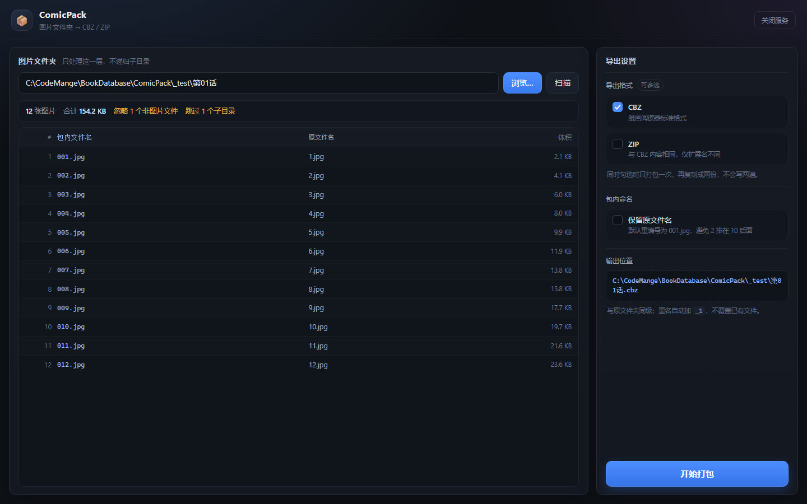

# ComicPack

把一个文件夹里的图片，按顺序打包成 **CBZ / ZIP**，方便漫画阅读器（CDisplayEx、YACReader、Mihon、Perfect Viewer 等）直接当书读。

双击 **`启动.bat`** 即可，页面会以浏览器「应用窗口」形式打开。



## 使用

1. 点「浏览…」选择图片文件夹（也可以直接把路径粘进输入框，带引号也能识别）→ 自动扫描
2. 左侧确认清单，**序号就是包内顺序**
3. 右侧勾选导出格式（CBZ / ZIP，可多选），按需勾「保留原文件名」
4. 点「开始打包」

输出与原文件夹同级，例如 `D:\漫画\第01话\` → `D:\漫画\第01话.cbz`。
重名不覆盖，自动变成 `第01话_1.cbz`；多格式共用同一个序号，不会出现 `_3.cbz` 配 `_1.zip` 的错位。

## 打包规则

| 规则 | 说明 |
| --- | --- |
| 自然排序 | `1.jpg < 2.jpg < 10.jpg`，不是字典序的 `1, 10, 2` |
| 零填充重编号 | 默认写成 `001.jpg`、`002.jpg`…，位数按图片数量自动取（至少 3 位） |
| 只处理一层 | 不进子目录；`Thumbs.db`、`desktop.ini` 等杂物和非图片文件直接忽略 |
| 不重复压缩 | 图片用 `ZIP_STORED` 原样存入——JPEG/PNG 再 deflate 几乎不减小，只浪费时间 |
| 多格式只写一次 | 同时勾 CBZ + ZIP 时先打一份，再复制成两份 |
| 原子写入 | 先写 `.part` 再改名，中途失败不会留下半成品冒充成品 |

## 环境

- Python 3.10+（本机实测 3.14.5）
- **零第三方依赖**，只用标准库（`zipfile` / `tkinter` / `http.server`）
- 自动复用上级（或上上级）目录的 `.venv`，找不到则回退系统 `python`
- 服务只监听 `127.0.0.1`，默认端口 `8765`，被占用自动顺延

## 文件

```
ComicPack/
├─ 启动.bat        双击启动
├─ app.py          HTTP 服务、原生选目录对话框、接口
├─ packer.py       扫描 / 自然排序 / 打包核心
├─ static/         前端页面（原生 JS，无框架）
└─ docs/           界面截图
```

## 接口

| 方法 | 路径 | 说明 |
| --- | --- | --- |
| POST | `/api/browse` | 弹 Windows 原生选目录框，返回真实路径 |
| POST | `/api/scan` | 扫描文件夹，返回图片清单（已排序） |
| POST | `/api/pack` | 开始打包，立即返回任务 id |
| GET | `/api/job/<id>` | 查询进度 / 结果 |
| POST | `/api/cancel/<id>` | 取消打包并删除半成品 |
| POST | `/api/reveal` | 在资源管理器中定位生成的文件 |
| POST | `/api/shutdown` | 关闭服务 |

## 已知限制

- 一次处理一个文件夹；批量多选、顺带压缩图片体积尚未实现
- 选目录对话框由**服务端进程**弹出，所以服务与浏览器必须在同一台机器上（本项目就是本地工具）
- 不生成 `ComicInfo.xml` 元数据
