# ComicPack

把图片文件夹按顺序打包成 **CBZ / ZIP**、在浏览器里**翻页阅读**，还能把剧集视频按 **Emby 规则改名**——
一个本地小工具，只监听 `127.0.0.1`，双击 `启动.bat` 就能用。

无第三方依赖，纯 Python 标准库（`zipfile` / `tkinter` / `http.server`）+ 原生 JS。


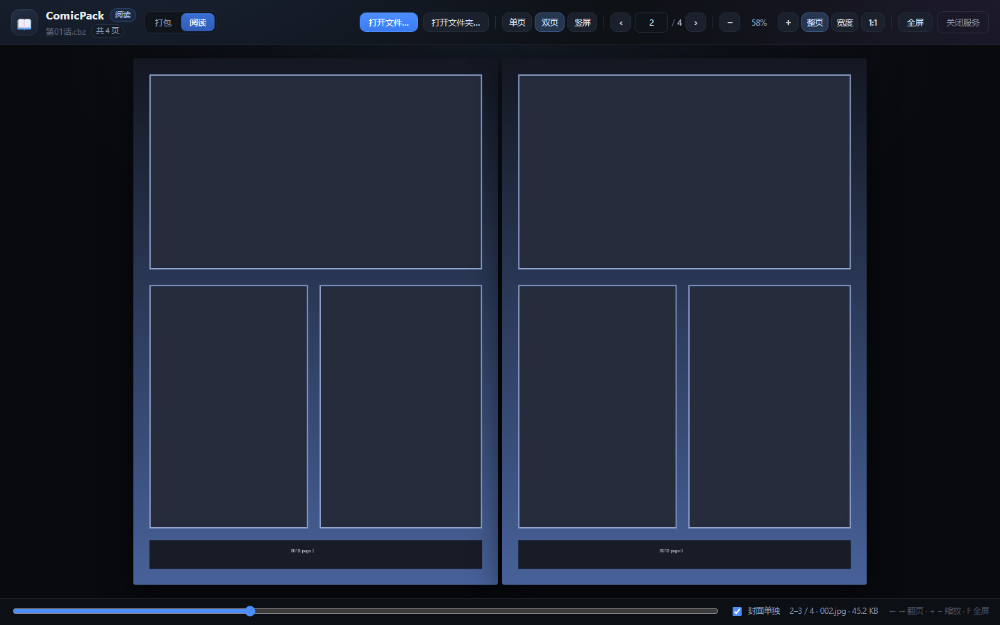

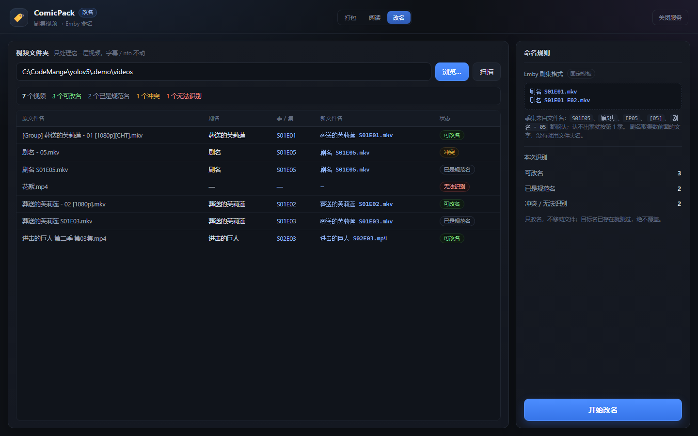

## 快速开始

1. 双击 **`启动.bat`**（需要 Python 3.10+）
2. 浏览器会以「应用窗口」形式打开页面
3. 顶部「打包 / 阅读 / 改名 / 整理 / 剧集」随时切换

服务默认端口 `8765`，被占用会自动顺延；窗口右上角「关闭服务」或直接关掉命令行窗口即可停止。

## 打包

把一个文件夹里的图片压成漫画包，给 CDisplayEx、YACReader、Mihon、Perfect Viewer 等阅读器直接当书读。

1. 点「浏览…」选择图片文件夹（也可以直接粘贴路径，带引号也能识别）→ 自动扫描
2. 左侧确认清单，**序号就是包内顺序**
3. 右侧勾选导出格式（CBZ / ZIP，可多选），按需勾「保留原文件名」
4. 需要的话勾上「**打包后删除原图片**」，点「开始打包」，完成后可以直接点「阅读」打开这个包

输出与原文件夹同级，例如 `D:\漫画\第01话\` → `D:\漫画\第01话.cbz`；重名不覆盖，自动变成 `第01话_1.cbz`。

### 封面会一起打包

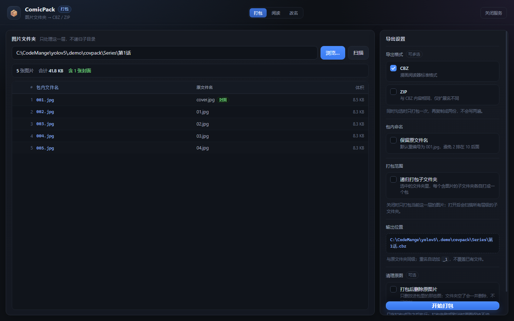

- 文件夹里有 `cover.jpg` / `封面.png` / `poster.*` / `folder.*` / `front.*` 时，会把它排到**包内第一张**，
  阅读器一般拿第一张当封面
- 图片在 `第1话/`、封面在上一级（`系列/cover.jpg` 或 `系列.jpg`）时，也会自动借用上级封面打进包
- 借用来的上级封面只进包，**不会**在「删除原图片」时被删掉（可能被同一部漫画的多个章节共用）
- 列表里封面行会标一个绿色「封面」角标，汇总行显示「含 N 张封面」

### 递归打包（整卷一次搞定）

勾上右侧「**递归打包子文件夹**」后，选中一个总文件夹，程序会把里面**每一层**含图片的子文件夹
各自打成一个包（输出仍在该子文件夹的同级）：

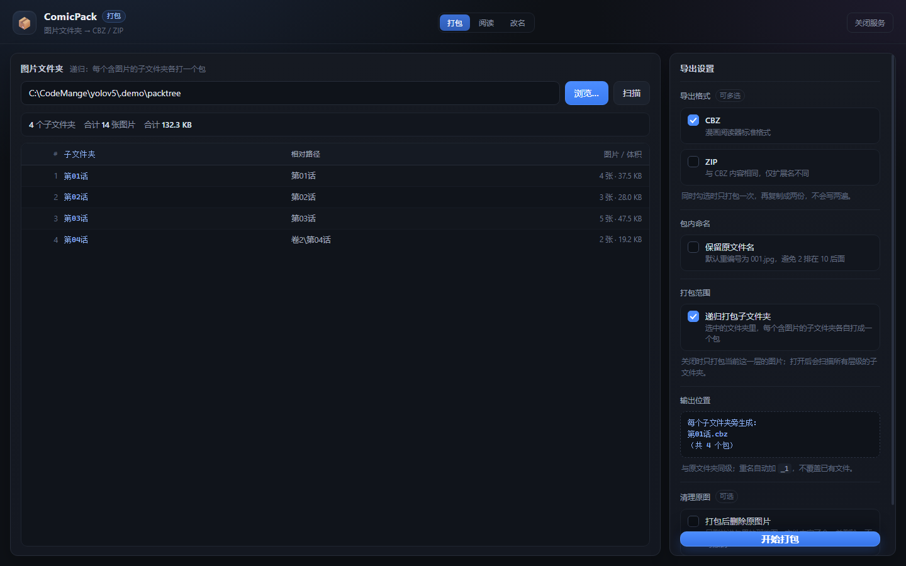

- 列表会变成「子文件夹 / 相对路径 / 图片数 / 体积」，可以一眼核对要打几本
- 进度条按**总图片数**累计，旁边显示当前在打哪个子文件夹
- 「打包后删除原图片」同样生效：每个子文件夹打包成功后删自己的原图，空了连文件夹一起删
- 只跳过不含图片的文件夹和系统目录；只有封面、没有正片图片的文件夹会被跳过，不产生空包

| 规则 | 说明 |
| --- | --- |
| 自然排序 | `1.jpg < 2.jpg < 10.jpg`，不是字典序的 `1, 10, 2` |
| 零填充重编号 | 默认写成 `001.jpg`、`002.jpg`…，位数按图片数量自动取（至少 3 位） |
| 封面优先 | `cover.*` / `封面.*` / `poster.*` / `folder.*`，或上级同名封面，会排到包内第一张 |
| 单层 / 递归 | 默认只处理选中文件夹这一层；勾「递归打包子文件夹」后遍历所有层 |
| 不重复压缩 | 图片用 `ZIP_STORED` 原样存入——JPEG/PNG 再 deflate 几乎不减小，只浪费时间 |
| 多格式只写一次 | 同时勾 CBZ + ZIP 时先打一份，再复制成两份 |
| 原子写入 | 先写 `.part` 再改名，中途失败不会留下半成品冒充成品 |
| 删除原图 | 只在打包**成功之后**执行：删掉本次放进包里的图片，文件夹空了连文件夹一起删；失败或取消时原图不动；借用的上级封面不删 |

## 阅读

顶栏只有一个入口：**「打开漫画文件夹…」**。选好文件夹后，会把它（**含所有子文件夹**）里的
`.cbz` / `.zip` 全部找出来，以**封面墙**的形式铺开：

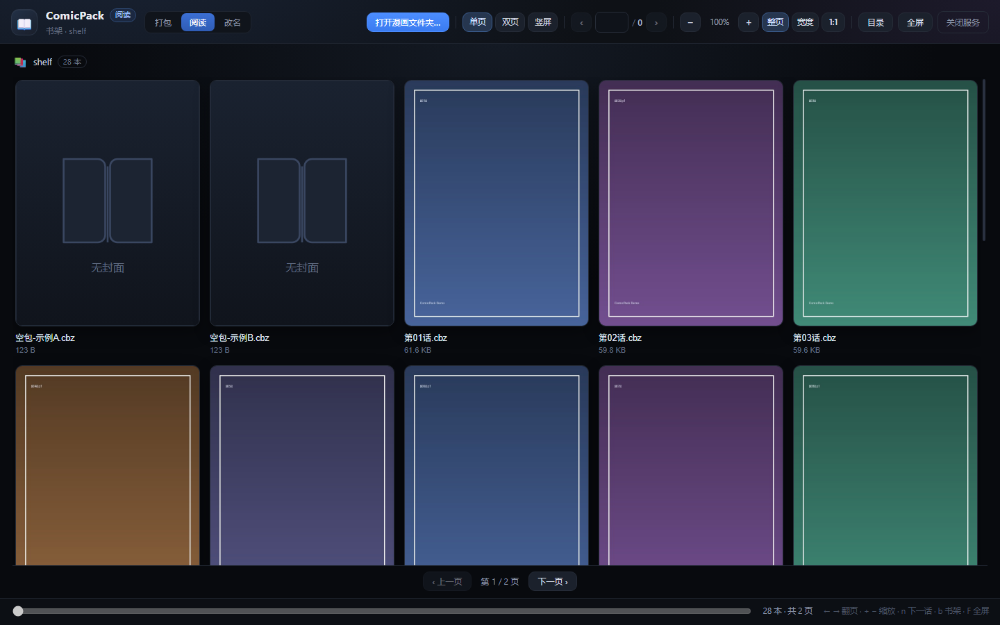

- 有配套封面图就用封面：同目录的 `同名.jpg/png`，或 `cover.* / poster.* / 封面.*`
- 没有封面就用包内第一页当封面
- 连图都没有（空包 / 坏包）就显示内置的默认封面 SVG
- **一个封面对应多本 cbz**（同一部漫画的不同单元集）时只出现一张封面卡，
  左下角用圆圈数字标出话数，标题用文件夹名
- 也支持「`系列.zip` 封面 + `系列/` 文件夹（里面是 `第1话.zip`、`第2话.zip`…）」这种结构：
  文件夹里的包合并成一张卡，那张只有 1 页的封面 zip 只当封面、不再单独成卡
- 每页 25 张封面，底部「上一页 / 下一页」翻页；左上角显示文件夹名和总数
- 点封面进入阅读；阅读页左上角有 **「‹ 书架」**，点了回到封面墙
- **回书架会停在原来那一页**（每页页码按文件夹记在 localStorage，刷新也不丢）

顶栏文件名的徽章平时（封面墙）显示灰色的话数，**进入阅读才亮起**：

| 界面 | 徽章 |
| --- | --- |
| 封面墙 | `共 12 话`（置灰） |
| 阅读中 | `第 3/12 话`（高亮） |

选择文件夹用的是应用内弹窗（不依赖系统对话框），可以粘路径、切盘符、上一级：

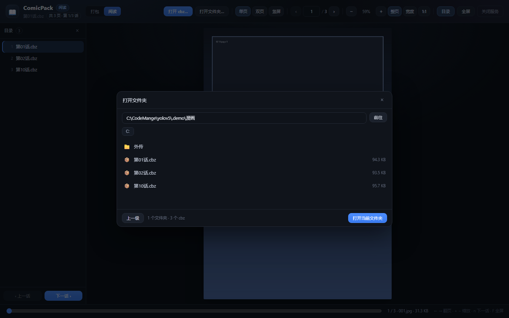

### 章节目录 / 连续阅读

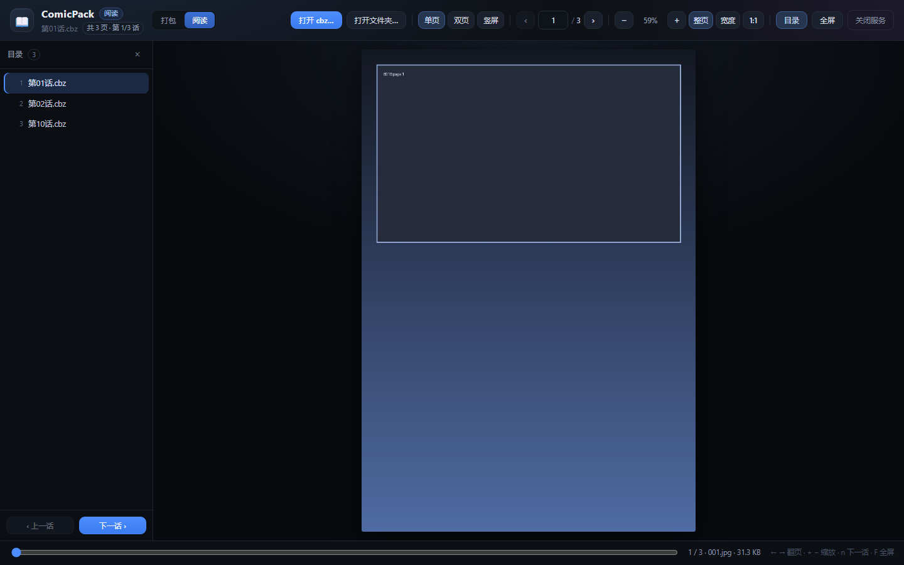

- **左侧**「目录」按文件名**自然排序**列出同目录的所有包（`第1话 < 第2话 < 第10话`），当前这本高亮
- 点任意一章立即切换；底部「上一话 / 下一话」或直接按 `n` 看下一话
- 每话的阅读进度单独记录，切回来还停在原来那一页
- 顶栏徽章显示「第 2/15 话」，方便知道读到第几本
- 窗口窄或想专心看图时，点顶栏「目录」可以收起侧边栏（状态会记住）

### 三种阅读模式

| 模式 | 说明 |
| --- | --- |
| 单页 | 一次一页，适合普通翻页 |
| 双页 | 两页并排，中间留 6px 缝避免贴死；可勾「封面单独」让第 1 页自己一屏 |
| 竖屏 | 连续纵向滚动，适合条漫/长图；滚动时页码自动跟随 |

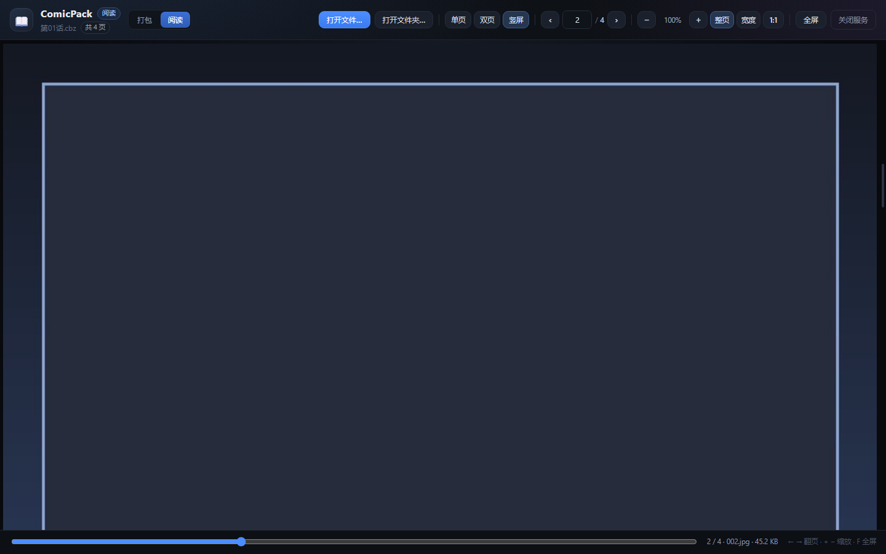

顶栏徽章显示当前是第几话，页码进度看顶部页码框和底部滑杆。

- 翻页：`←` `→`、`PageUp` / `PageDown`、空格、滚轮（未放大时）
- 缩放：`+` / `-`，`Ctrl + 滚轮`，或点「整页 / 宽度 / 1:1」
- 跳转：底部滑杆，或直接在页码框里输入数字回车；链接里也可以用 `?path=…&mode=double&page=3`
- `Home` / `End` 跳到首尾，`n` 下一话，`b` 回书架，`F` 全屏，`O` 打开文件夹
- 自动记住每个文件的阅读进度与上次用的模式（存在浏览器 localStorage 里）
- 只读：阅读过程不会改动、解压或重新压缩原文件

## 视频改名

手动改名：选一个文件夹，**只列这一层**的视频，双击文件名直接改，点「确认改名」才落盘。


1. 选文件夹 → 列出里面的视频（不递归子文件夹，非视频文件忽略）
2. **双击文件名** → 输入新名字 → 回车确认（Esc 取消）；改过的行标绿、状态「已修改」
3. 点「确认改名」→ 一次性应用所有改动，然后自动重新扫描

| 规则 | 说明 |
| --- | --- |
| 不递归 | 只处理选中文件夹这一层的视频，子文件夹不参与 |
| 扩展名 | 只改名字、不能改扩展名；没写扩展名会自动补上原来的 |
| 重名 | 目标已存在会被跳过（原因会列出来），绝不覆盖 |
| 交换名字 | A→B、B→A 这种也能正确处理（内部先换成临时名） |
| 原子性 | 中途失败会全部回滚，文件保持原名 |
| 预览 | 点「确认改名」之前，所有修改都只在页面上，不动磁盘 |

> 想按 `剧名 S01E01` 自动整理成 Emby 结构，用「剧集」页（见下）。

## 视频整理

给一个根目录（里面是层层子文件夹 + 视频），在网页上把视频重新归到你自己建的文件夹里：

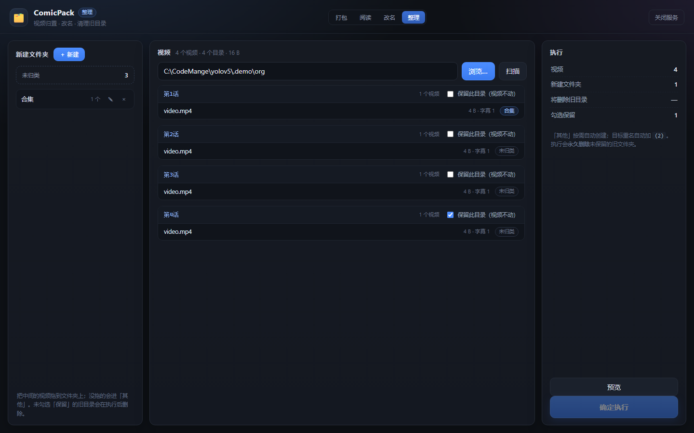

1. 选文件夹 → 递归列出所有视频（自动匹配同名字幕，如 `第1话.chs.ass`）
2. 左栏「＋ 新建」建文件夹；把中间的视频**拖**到文件夹上（支持多选），文件名点一下就能就地改
3. 某个原目录想原样留着，勾上「保留此目录」——里面的视频不动、目录也不删
4. 「预览」看清将新建 / 移动 / 改名 / 删除什么，再「确定执行」

| 规则 | 说明 |
| --- | --- |
| 未归类 | 没拖进任何文件夹的视频，执行时自动进「其他」 |
| 清理旧目录 | 未勾「保留」的原目录会被**永久删除**（包括里面视频没动过的目录） |
| 保留目录 | 勾选的目录不删；里面的视频默认不动，除非被拖走 |
| 改名 | 只改名字、不能改扩展名；字幕跟着视频一起改名/移动 |
| 重名 | 目标重名自动加 `(2)`；新建文件夹与已有目录重名会被拒绝 |
| 安全 | 只支持同盘（移动是瞬时改名）；移动阶段任何失败整单回滚；删除失败只报告，失败目录原样保留 |

## Emby 剧集

把一堆剧集视频整理成 Emby 认的目录结构：**剧名由你填**（不从文件名猜），集数从文件名解析。

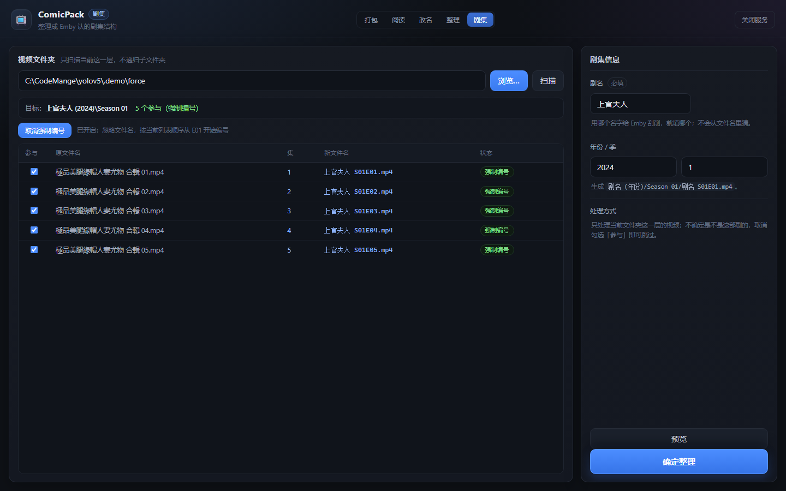

1. 选文件夹（**只扫描当前这一层**，不递归子文件夹，自动匹配同名字幕）
2. 右边填 **剧名**（必填）、年份（可空）、季（默认 1）
3. 文件名认不出集数时（比如结尾只有 ` 01`、` 02`，或带 `24V` 这类后缀），
   点「**全选并强制编号**」：忽略文件名，按当前列表顺序从 `E01` 开始编号
4. 不确定是不是这部剧的，把那一行的「参与」取消勾选，就不会被移动
5. 「预览」→ 显示目标目录、每个文件的新名字、**缺号**
6. 「确定整理」→ 生成：

```
剧名 (年份)/Season 01/剧名 S01E01.mp4
剧名 (年份)/Season 01/剧名 S01E01.chs.ass
```

| 规则 | 说明 |
| --- | --- |
| 集数识别 | `S01E01`、`第01集`、`[01]`、`(01)`、`剧名 - 01`、纯数字 `01.mp4` |
| 强制编号 | 默认规则认不出时，点「全选并强制编号」按当前顺序编号（可再点一次取消） |
| 剧名 | 只认你输入的；文件名里的剧名不参与 |
| 只扫一层 | 不递归：上次生成的 `剧名/Season 01/` 不会被再次扫进来 |
| 取消参与 | 每行一个勾选，取消后该视频留在原处，不移动、不改名 |
| 缺号 | 预览时列出（例如 61–65 缺 64），方便你补档 |
| 字幕 | 同名同语言后缀的字幕跟着改名移动 |
| 安全 | 同盘移动；失败整单回滚；目标重名自动加 `(2)` |

整理完在 Emby 里：控制台 → 媒体库 → 添加媒体库 → 类型选「电视节目」→ 文件夹指向
**剧名文件夹的上一级**（例如整批放在 `D:\动漫`，就选 `D:\动漫`）→ 扫描媒体库即可刮削。

## 播放视频

直接播放本地视频，带**倍速**、**音量**和拖动进度，4K 也能放：

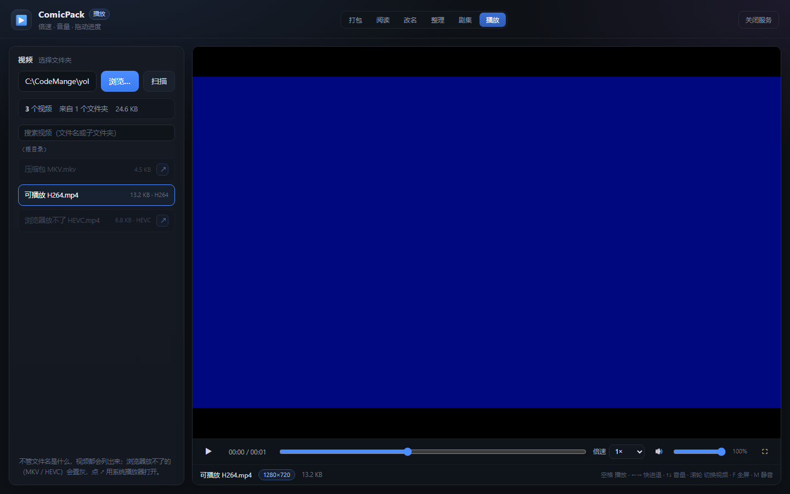

1. 选文件夹（或直接粘贴某个视频文件的路径）→ 扫描（**递归找子文件夹**，平铺和任意嵌套都能读）
2. 左边**按文件夹分组**列出；顶部可以按文件名 / 子文件夹搜索
3. 点视频开始播放；在播放器区域**滚轮**可以切换上一个 / 下一个
4. 控制条：播放/暂停、进度、倍速（0.5×–3×）、静音、音量、全屏
5. 会自动记住上次的倍速和音量

| 特性 | 说明 |
| --- | --- |
| 目录结构 | 递归扫描：`剧名/Season 01/第01话.mp4`、`随便/深层/第1集.mp4` 等任意结构都能列出来，**不要求 Emby 结构** |
| 全部显示 | 不按文件名过滤：不管叫什么、像不像剧集，都会列出来 |
| 置灰 | 浏览器放不了的（MKV/HEVC 等）名字置灰、点不动，右侧有 ↗ 用系统播放器打开 |
| 分组 / 搜索 | 列表按所在文件夹分组，顶部搜索框按文件名或子文件夹过滤 |
| Range 流 | 后端支持 HTTP Range：拖动进度只读需要的片段，4K 大文件不用整段加载 |
| 4K | 显示实际分辨率并标「4K」；能不能解码取决于浏览器和显卡（H.264 MP4 最稳） |
| 滚轮切换 | 在播放器区域滚轮切换上一个/下一个视频（左侧列表保留自己的滚动） |
| 格式 | MP4/WebM 一般能播；MKV、HEVC 多数浏览器不支持，会提示转码 |
| 快捷键 | 空格 播放/暂停、←→ 快进/后退 5 秒、↑↓ 音量、F 全屏、M 静音 |

## 项目结构

```
app.py          HTTP 服务：路由、原生对话框、打包任务、阅读接口、改名与整理接口
packer.py       扫描 / 自然排序 / 重编号 / 打包核心（含删除原图）
reader.py       封面墙扫描（递归 + 封面）、打开 CBZ / ZIP、按页取图
namer.py        手动改名（列视频 / 改名 / 回滚）+ 剧集解析（给 Emby 页用）
organizer.py    视频整理：扫描 / 计划 / 执行 / 回滚（同盘移动）
emby.py         剧集整理：扫描 / 预览 / 建 剧名/Season 01/ 并移动改名
static/
  index.html    打包页
  reader.html   阅读页（封面墙 + 阅读器）
  rename.html   视频改名页
  organize.html 视频整理页
  emby.html     Emby 剧集页
  play.html     播放页
  cover-default.svg  默认封面
  style.css     公共样式
  app.js        打包页逻辑
  reader.css    阅读页样式
  reader.js     阅读页逻辑
  rename.js     改名页逻辑
  organize.css  整理页样式
  organize.js   整理页逻辑
  emby.js       剧集页逻辑
  play.css      播放页样式
  play.js       播放页逻辑
tests/          单元测试（标准库 unittest）
docs/           界面截图
启动.bat        双击启动
```

## 接口

| 方法 | 路径 | 说明 |
| --- | --- | --- |
| POST | `/api/browse` | 弹 Windows 原生选目录框，返回真实路径 |
| POST | `/api/scan` | 扫描文件夹，返回图片清单（已排序）；`recursive: true` 时返回含图片的子文件夹列表 |
| POST | `/api/pack` | 开始打包（`formats` / `keep_names` / `delete_source` / `recursive`），立即返回任务 id |
| GET | `/api/job/<id>` | 查询打包进度 / 结果 |
| POST | `/api/cancel/<id>` | 取消打包并删除半成品 |
| POST | `/api/reveal` | 在资源管理器中定位生成的文件 |
| POST | `/api/library/scan` | 封面墙：递归扫出文件夹（含子文件夹）里的 cbz/zip，带封面来源（`file` / `zip` / 空） |
| GET | `/api/library/cover?path=<cbz>` | 取封面图：同目录配套封面优先，否则包内第一页 |
| POST | `/api/reader/list` | 选择弹窗用：列目录（子文件夹 + cbz/zip + 盘符），`path` 为空时从用户主目录开始 |
| POST | `/api/reader/open` | 打开漫画包；返回页清单与同目录章节（`chapters` / `chapter_index`） |
| GET | `/api/reader/page/<sid>/<n>` | 取第 n 页图片（0 基） |
| POST | `/api/reader/close/<sid>` | 关闭阅读会话 |
| POST | `/api/rename/scan` | 列当前这一层的视频（不递归、不解析），给手动改名用 |
| POST | `/api/rename/apply` | 按 `names: [{from, to}]` 改名：只改名字不改扩展名，重名跳过、整体失败回滚 |
| POST | `/api/organize/scan` | 视频整理：递归扫出视频与同名字幕 |
| POST | `/api/organize/plan` | 预演整理计划（新建/移动/改名/删除），不落盘 |
| POST | `/api/organize/apply` | 执行整理：同盘移动/改名，移动失败整单回滚 |
| POST | `/api/emby/scan` | 剧集扫描：**只扫当前一层**（不递归），解析 `S01E01` / `第1集` / `[01]` / `(01)` / `剧名 - 01` |
| POST | `/api/emby/build` | 预演 Emby 结构：剧名/年份/季由用户填，`exclude` 指定取消参与的文件，`force` 按顺序强制编号，返回目标目录、新名字、缺号 |
| POST | `/api/emby/apply` | 建 `剧名 (年份)/Season 01/` 并移动/改名（字幕跟随，失败回滚，跳过被取消的文件） |
| POST | `/api/video/list` | 播放页：**递归**列出视频（也接受单个视频文件路径），返回相对路径便于区分同名文件 |
| GET | `/api/video/stream?path=` | 视频流：支持 `Range`（206），4K 拖动进度用 |
| GET | `/api/video/probe?path=` | 探测编码/容器（ffprobe），返回浏览器能不能播 |
| POST | `/api/video/open` | 用系统默认播放器打开（MKV/HEVC 兜底） |
| POST | `/api/shutdown` | 关闭服务 |

## 测试

```bat
python -m unittest discover -s tests -v
```

覆盖自然排序、零填充、打包产物结构、删除原图（含“只删图片不动其它文件”）、
递归扫描与逐个打包（含递归删除原图）、包内页顺序、文件夹阅读、
封面墙（递归扫描 / 同名封面 / 包内首图 / 默认封面 / 同封面合并成一张卡）、
章节列表与序号、选择弹窗的目录列举（盘符 / 文件夹 / cbz 过滤）、视频改名解析（各站命名 / 纯数字 / 连播）、
改名执行与冲突跳过（含交换名字、保留扩展名、整体回滚）、视频整理（扫描 / 保留目录 / 未归类进「其他」/ 重名加序号 / 移动失败回滚 / 删除失败保留）、
Emby 剧集（只扫一层 / 括号集数 / 用户填剧名 / 取消单个 / 强制按顺序编号 / 缺号 / 建 Season 目录 / 失败回滚）、
视频流（Range 206 / 后缀范围 / 越界 416 / 递归视频列表 / 编码探测）、
坏包/空包、阅读会话上限，以及 HTTP 层的打开 / 取页 / 越界 404 /
封面墙扫描与封面取图 / 递归打包 / 改名 / 整理 / 剧集。

## 已知限制

- 一次处理一个文件夹、阅读一个包；批量处理尚未实现
- 封面墙只列 `.cbz` / `.zip`：纯图片文件夹不会出现在阅读页（可以先用「打包」做成 cbz）
- 阅读页用内置的选择弹窗，不再依赖系统对话框；打包页和改名页的「浏览…」仍会弹系统选目录框，
  所以服务和浏览器必须在同一台机器上
- 视频改名只处理**这一层**的视频文件：不进子目录、不处理字幕 / nfo / 封面
- 视频整理会**永久删除**未勾选「保留」的旧目录，执行前务必看清预览；只支持同盘整理
- 视频整理只支持一层新建文件夹（不支持父子嵌套）；字幕跟随，nfo / 封面图暂不处理
- 播放页依赖浏览器解码：MP4（H.264/AAC）最稳；MKV、HEVC、AV1 等放不了的会置灰，
  可点 ↗ 用系统播放器打开；编码探测用 ffprobe，没有 ffprobe 时按扩展名判断；
  4K 建议开硬件解码，软解可能卡顿
- 视频流走本地 HTTP Range，关闭服务后页面里的播放会立即中断
- Emby 剧集页只建 `剧名/Season 01/`，不做多季拆分（多季请按季分次执行）；只扫当前这一层，
  子文件夹里的视频不会被处理；不联网刮削，剧名/年份需要你自己填
- 不支持加密的 zip；不会生成 `ComicInfo.xml` 元数据
- 阅读器只做展示，不做图片重压缩；竖屏模式依赖浏览器 `loading="lazy"` 懒加载

> 本仓库早期是 YOLOv5 的实验脚本（`detect.py`、`train.py` 等），现已整体改为 ComicPack；
> 旧文件从当前目录移除，历史仍保留在 git 提交记录里。
