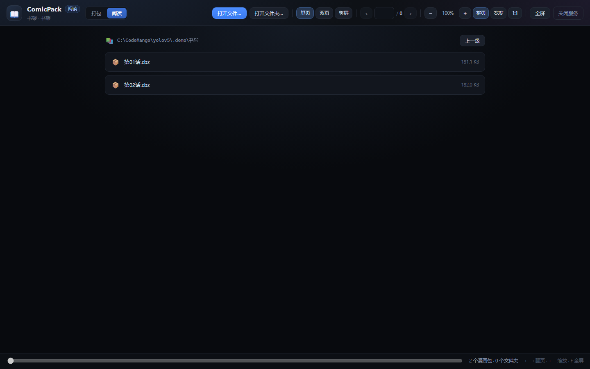

# ComicPack

把图片文件夹按顺序打包成 **CBZ / ZIP**、在浏览器里**翻页阅读**，还能把剧集视频按 **Emby 规则改名**——
一个本地小工具，只监听 `127.0.0.1`，双击 `启动.bat` 就能用。

无第三方依赖，纯 Python 标准库（`zipfile` / `tkinter` / `http.server`）+ 原生 JS。


## 快速开始

1. 双击 **`启动.bat`**（需要 Python 3.10+）
2. 浏览器会以「应用窗口」形式打开页面
3. 顶部「打包 / 阅读 / 改名」随时切换

服务默认端口 `8765`，被占用会自动顺延；窗口右上角「关闭服务」或直接关掉命令行窗口即可停止。

## 打包

把一个文件夹里的图片压成漫画包，给 CDisplayEx、YACReader、Mihon、Perfect Viewer 等阅读器直接当书读。

1. 点「浏览…」选择图片文件夹（也可以直接粘贴路径，带引号也能识别）→ 自动扫描
2. 左侧确认清单，**序号就是包内顺序**
3. 右侧勾选导出格式（CBZ / ZIP，可多选），按需勾「保留原文件名」
4. 需要的话勾上「**打包后删除原图片**」，点「开始打包」，完成后可以直接点「阅读」打开这个包

输出与原文件夹同级，例如 `D:\漫画\第01话\` → `D:\漫画\第01话.cbz`；重名不覆盖，自动变成 `第01话_1.cbz`。

| 规则 | 说明 |
| --- | --- |
| 自然排序 | `1.jpg < 2.jpg < 10.jpg`，不是字典序的 `1, 10, 2` |
| 零填充重编号 | 默认写成 `001.jpg`、`002.jpg`…，位数按图片数量自动取（至少 3 位） |
| 只处理一层 | 不进子目录；`Thumbs.db`、`desktop.ini` 等杂物直接忽略 |
| 不重复压缩 | 图片用 `ZIP_STORED` 原样存入——JPEG/PNG 再 deflate 几乎不减小，只浪费时间 |
| 多格式只写一次 | 同时勾 CBZ + ZIP 时先打一份，再复制成两份 |
| 原子写入 | 先写 `.part` 再改名，中途失败不会留下半成品冒充成品 |
| 删除原图 | 只在打包**成功之后**执行：删掉本次放进包里的图片，文件夹空了连文件夹一起删；失败或取消时原图不动 |

## 阅读

- 顶栏 **「打开 cbz…」**：打开选择弹窗，只挑 `.cbz` / `.zip`
- 顶栏 **「打开文件夹…」**：同一个弹窗里**文件夹和 cbz 一起列出**，点文件夹继续往里走，
  点包直接读，底部「打开当前文件夹」也可以把整个目录丢给阅读器


弹窗不依赖系统对话框：左边 ← 路径栏可以直接粘 `D:\漫画`，上面一排是盘符，
下面就是当前目录的文件夹和 cbz（带体积）；「上一级」回上层，`Esc` 或点遮罩关闭。
有散图的目录还会多一行「直接阅读本层 N 张图片」。



文件夹里放的全是散图、没有子文件夹时，会直接当一本来读，不再多一次点击。

### 章节目录 / 连续阅读


- **左侧**「目录」按文件名**自然排序**列出同目录的所有包（`第1话 < 第2话 < 第10话`），当前这本高亮
- 点任意一章立即切换；底部「上一话 / 下一话」或直接按 `n` 看下一话
- 每话的阅读进度单独记录，切回来还停在原来那一页
- 顶栏徽章会显示「共 N 页 · 第 2/15 话」，方便知道读到第几本
- 窗口窄或想专心看图时，点顶栏「目录」可以收起侧边栏（状态会记住）

### 三种阅读模式

| 模式 | 说明 |
| --- | --- |
| 单页 | 一次一页，适合普通翻页 |
| 双页 | 两页并排，中间留 6px 缝避免贴死；可勾「封面单独」让第 1 页自己一屏 |
| 竖屏 | 连续纵向滚动，适合条漫/长图；滚动时页码自动跟随 |


顶栏始终显示 **共 N 页** 与当前页码，底栏有整本进度条。

- 翻页：`←` `→`、`PageUp` / `PageDown`、空格、滚轮（未放大时）
- 缩放：`+` / `-`，`Ctrl + 滚轮`，或点「整页 / 宽度 / 1:1」
- 跳转：底部滑杆，或直接在页码框里输入数字回车；链接里也可以用 `?path=…&mode=double&page=3`
- `Home` / `End` 跳到首尾，`n` 下一话，`F` 全屏，`O` 打开文件
- 自动记住每个文件的阅读进度与上次用的模式（存在浏览器 localStorage 里）
- 只读：阅读过程不会改动、解压或重新压缩原文件

## 视频改名

针对 **剧集 / 番剧**：把一个文件夹里的视频按 **Emby 命名规则**改名，方便 NAS 播放器识别。
只解析现有文件名，不联网、不移动文件、不动字幕和 nfo。


1. 选文件夹 → 自动扫描出清单（**只是预览，不会改任何文件**）
2. 每行显示：原文件名、识别出的剧名、季 / 集、新文件名、状态
3. 确认无误后点「开始改名」，只处理状态为「可改名」的文件

| 状态 | 含义 |
| --- | --- |
| 可改名 | 识别成功、目标名不冲突，执行时会改 |
| 已是规范名 | 名字已经符合规则，跳过 |
| 冲突 | 目标文件名已存在，或两个文件要改成同一个名字 → 跳过，绝不覆盖 |
| 无法识别 | 找不到集数 / 剧名，保持原样并标红 |

命名格式固定为：

```
剧名 S01E01.mkv
剧名 S01E01-E02.mkv      （连播 / 合集）
```

集数识别支持 `S01E05`、`第5集`、`第5话`、`EP05`、`[05]`、`剧名 - 05`、纯数字 `05.mkv`；
季数支持 `S02`、`第二季`、`Season 2`，找不到就按第 1 季；
剧名取集数前面的文字（自动去掉 `[字幕组]`、`1080p`、`WEB-DL` 这类标签），没有就用文件夹名。

## 项目结构

```
app.py          HTTP 服务：路由、原生对话框、打包任务、阅读接口、改名接口
packer.py       扫描 / 自然排序 / 重编号 / 打包核心（含删除原图）
reader.py       打开 CBZ / ZIP（或图片文件夹 / 书架），按页取图
namer.py        剧集视频解析与 Emby 风格改名（先预览、不覆盖）
static/
  index.html    打包页
  reader.html   阅读页
  rename.html   视频改名页
  style.css     公共样式
  app.js        打包页逻辑
  reader.css    阅读页样式
  reader.js     阅读页逻辑
  rename.js     改名页逻辑
tests/          单元测试（标准库 unittest）
docs/           界面截图
启动.bat        双击启动
```

## 接口

| 方法 | 路径 | 说明 |
| --- | --- | --- |
| POST | `/api/browse` | 弹 Windows 原生选目录框，返回真实路径 |
| POST | `/api/scan` | 扫描文件夹，返回图片清单（已排序） |
| POST | `/api/pack` | 开始打包（`formats` / `keep_names` / `delete_source`），立即返回任务 id |
| GET | `/api/job/<id>` | 查询打包进度 / 结果 |
| POST | `/api/cancel/<id>` | 取消打包并删除半成品 |
| POST | `/api/reveal` | 在资源管理器中定位生成的文件 |
| POST | `/api/reader/list` | 选择弹窗用：列目录（子文件夹 + cbz/zip + 盘符），`path` 为空时从用户主目录开始 |
| POST | `/api/reader/open` | 打开漫画包；或打开文件夹（`prefer_images=false` 返回 `kind: "library"` 书架：子文件夹 + 包 + 本层图片入口）；返回页清单与同目录章节（`chapters` / `chapter_index`） |
| GET | `/api/reader/page/<sid>/<n>` | 取第 n 页图片（0 基） |
| POST | `/api/reader/close/<sid>` | 关闭阅读会话 |
| POST | `/api/rename/scan` | 预览视频改名：解析每个视频并给出新名字与状态（只算不改） |
| POST | `/api/rename/apply` | 执行改名（`path`，可选 `names` 只改指定文件），跳过冲突、绝不覆盖 |
| POST | `/api/shutdown` | 关闭服务 |

## 测试

```bat
python -m unittest discover -s tests -v
```

覆盖自然排序、零填充、打包产物结构、删除原图（含“只删图片不动其它文件”）、
包内页顺序、文件夹阅读、书架（子文件夹 / 包 / 本层图片入口）、章节列表与序号、
选择弹窗的目录列举（盘符 / 文件夹 / cbz 过滤）、视频改名解析（各站命名 / 纯数字 / 连播）、
改名执行与冲突跳过、坏包/空包、阅读会话上限，以及 HTTP 层的打开 / 取页 / 越界 404 / 改名。

## 已知限制

- 一次处理一个文件夹、阅读一个包；批量处理尚未实现
- 阅读页用内置的选择弹窗，不再依赖系统对话框；打包页和改名页的「浏览…」仍会弹系统选目录框，
  所以服务和浏览器必须在同一台机器上
- 视频改名只处理**这一层**的视频文件：不进子目录、不处理字幕 / nfo / 封面
- 视频改名纯离线解析文件名，不联网刮削：拿不到正式剧名、年份、集标题；
  认不出的文件会标为「无法识别」并保持原样
- 不支持加密的 zip；不会生成 `ComicInfo.xml` 元数据
- 阅读器只做展示，不做图片重压缩；竖屏模式依赖浏览器 `loading="lazy"` 懒加载

> 本仓库早期是 YOLOv5 的实验脚本（`detect.py`、`train.py` 等），现已整体改为 ComicPack；
> 旧文件从当前目录移除，历史仍保留在 git 提交记录里。
